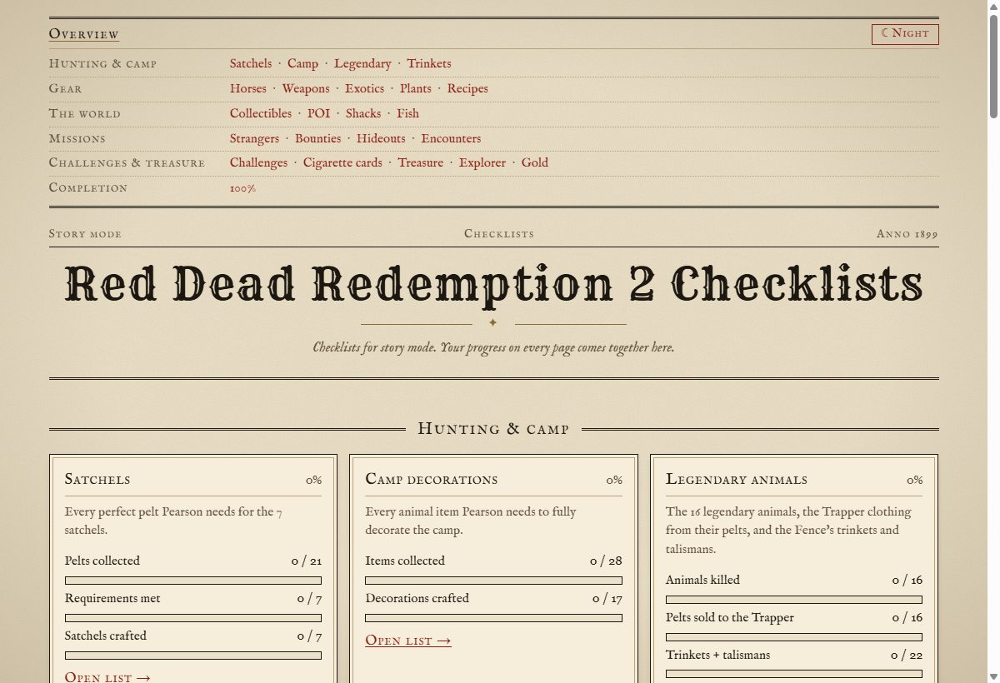

# Red Dead Redemption 2 Checklists

Checklists for everything you can collect, hunt and complete in **Red Dead Redemption 2 story mode**, styled like a newspaper from 1899.

**[Open the app →](https://visserdavid.github.io/RedDeadRedemption2/)**



## Features

- **23 checklists**, grouped like a table of contents:
  - **Hunting & camp:** satchels, camp decorations, legendary animals, trinkets & talismans
  - **Gear:** horses, weapons, exotics, plants, recipes
  - **The world:** collectibles (dinosaur bones, dreamcatchers, rock carvings, graves), points of interest, shacks, legendary fish
  - **Missions:** stranger missions, bounties, gang hideouts, chance encounters
  - **Challenges & treasure:** all 90 challenges, cigarette cards, treasure maps, Explorer treasures, gold bars
  - **Completion:** a 100% checklist
- **Linked lists.** Shared items are one checkbox: a trinket crafted on the Trinkets page is also checked on Legendary animals. Counts feed into other pages automatically; the 100% page, for example, picks up your weapons, plants, graves and challenges.
- **Where, when and how.** Every item has its location, requirements and tips. Missable items and epilogue-only items are marked.
- **Progress meters** on every page and on the overview.
- **Day and night theme:** light "newspaper & poster" and dark "leather & lamplight". It follows your system setting until you choose one.
- **Works on a phone, and offline from a local copy.** No account, no server, no tracking.

Your progress is saved only in your own browser (`localStorage`). Clearing your browser data clears your progress, and progress does not sync between devices or browsers.

## Running it locally

There is no build step and there are no dependencies. Clone the repository and open `index.html` in a browser; it also works straight from disk (`file://`). Pages are hash routes, for example `index.html#/weapons`.

## Tests

```sh
node tests/smoke.mjs [path-to-chrome]
```

This end-to-end test starts headless Chrome or Edge and drives the app over the DevTools protocol. It checks that:
- every page renders without errors;
- progress persists after a reload;
- cross-list links work;
- the layout fits a 375px phone screen.

It needs Node.js 22 or newer (for the built-in `WebSocket`).

## How it is built

Plain HTML, CSS and JavaScript, using classic `<script>` tags so it keeps working from `file://`.

| Path | What it is |
| --- | --- |
| `index.html` | The page shell. |
| `assets/app.js` | The core: list registration, rendering, storage and routing. The list format is documented at the top of this file. |
| `assets/style.css` | The 1899 theme. |
| `assets/fonts/` | [Rye](https://fonts.google.com/specimen/Rye) and [IM Fell English](https://fonts.google.com/specimen/IM+Fell+English), bundled locally (SIL Open Font License). |
| `data/<list>.js` | One file per checklist: its items, tips and sources. |
| `tests/smoke.mjs` | The end-to-end test. |

[`CLAUDE.md`](CLAUDE.md) covers the architecture in more detail, including storage keys and how to add a list.

## Sources

The content is compiled from community guides such as rdr2.org, PowerPyx, the Red Dead Wiki and others. Every page lists the sources it uses at the bottom. Found a mistake? Please [open an issue](https://github.com/visserdavid/RedDeadRedemption2/issues).

## Disclaimer

This is an unofficial fan project. It is not affiliated with or endorsed by Rockstar Games or Take-Two Interactive. *Red Dead Redemption* is a trademark of Take-Two Interactive Software, Inc.
